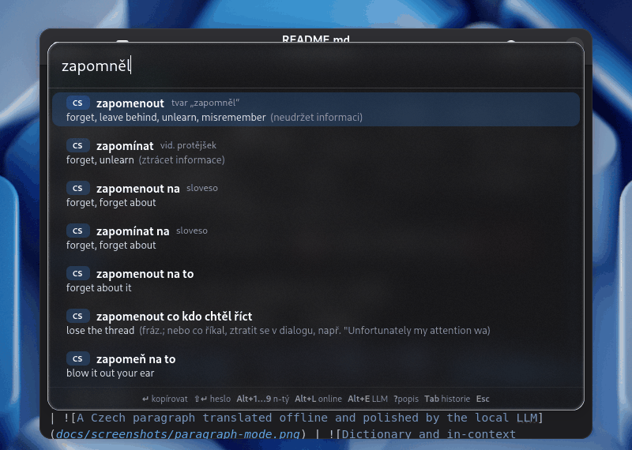
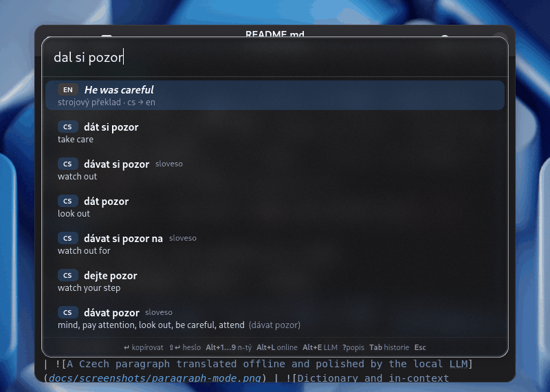
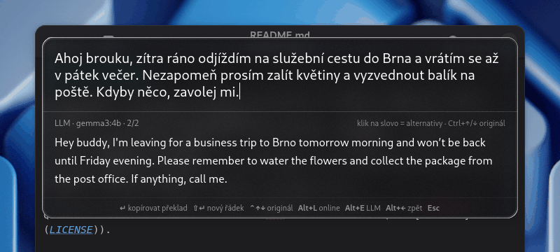
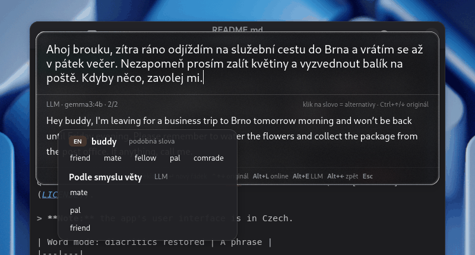
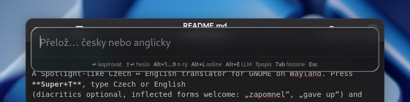
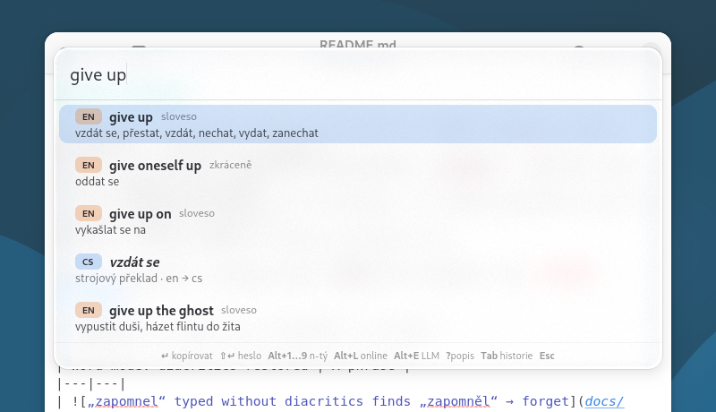
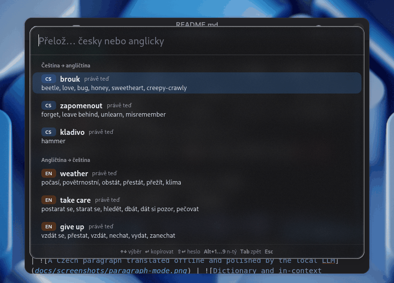

# Quick Translate

A Spotlight-like Czech ↔ English translator for GNOME on Wayland. Press **Super+T**, type Czech or English
(diacritics optional, inflected forms welcome: „zapomnel“, „gave up“) and results appear as you type.
It works **offline first**: the dictionary, the machine translation and the optional LLM all run on your
computer. Nothing leaves it unless you press Alt+L.

Quick Translate is licensed under **GPL-2.0-or-later** (see [LICENSE](LICENSE)).

> **Note:** the app's user interface is in Czech.

| Word mode: diacritics restored | A phrase |
|---|---|
|  |  |
| **Paragraph mode** | **Word alternatives (click a word)** |
|  |  |

## Features

- **Dictionary with inflected forms.** About 200 000 headwords and 370 000 Czech word forms: „zapomněl“ finds
  *zapomenout → forget*, with labels that say why a row is there (in the Czech UI: inflected form, aspect counterpart,
  without the reflexive *se/si*, phrase from the query, typo?). A search takes ~0.5 ms per keystroke.
- **Phrases and typos.** Multi-word phrases („dát si pozor“, „give up“) and a typo-tolerant fallback.
- **Automatic diacritics.** Czech typed without diacritics gets them back as soon as you finish a word:
  „jak se mas “ → „jak se máš “. The cursor stays where it was and Ctrl+Z undoes the fix. English text and
  words you typed with diacritics are left alone.
- **Offline machine translation** with the [Firefox Translations](https://github.com/mozilla/firefox-translations-models)
  (Bergamot) models, for phrases and sentences the dictionary does not know.
- **Paragraph mode.** Select a paragraph anywhere (e.g. in the browser) and press Super+T: it is translated
  sentence by sentence right away; a Czech paragraph is then refined by the local LLM. Switch between the
  original and the translation, between translation versions (machine, online, LLM, edited), and click any
  word of the translation to replace it with a dictionary alternative or a context-aware LLM suggestion.
- **Optional online translation** with [LINDAT](https://lindat.mff.cuni.cz/services/translation/)
  (ÚFAL, Charles University) — only on Alt+L.
- **Optional local LLM** via [ollama](https://ollama.com) (default model `gemma3:4b`) for natural paragraph
  translations and word suggestions.
- **Describe a word** („it is on the tip of my tongue“): `?nástroj na zatloukání hřebíků` finds *kladivo /
  hammer*; Alt+E asks the local LLM, whose Czech suggestions are verified against the dictionary.
- **Word history on Tab:** the last three Czech and three English words you translated.
- **GNOME Shell extension** (optional, recommended): puts the popup at the top of the screen like Spotlight,
  gives it reliable focus, closes it on a click outside and draws **Liquid Glass** under it — frosted glass
  that refracts the wallpaper and windows at its edges (the material of [Atelier](https://github.com/knespii/atelier)).



*The empty popup right after Super+T: a hint line lists the keys. Below: GNOME's light style.*



## Keyboard shortcuts

### Word mode

| Key | Action |
|---|---|
| Super+T | open / close (the selected text is prefilled) |
| ↑ ↓, PgUp PgDn | select a row |
| Enter | copy the translation and close |
| Shift+Enter | copy the headword (the word you searched for) |
| Alt+1 … Alt+9 | copy the n-th translation of the selected row |
| Alt+L | online translation via LINDAT — the only thing that goes to the internet |
| `?description` | find a word by its description, e.g. `?nástroj na zatloukání hřebíků` |
| Alt+E | ask the local LLM for the described word (or a better translation) |
| Alt+← | undo: remove the row added by Alt+L or Alt+E |
| Tab | recently translated words (Tab again or typing returns to the results) |
| Ctrl+Z | undo typing, including an automatic diacritics fix |
| Esc | close |

### Paragraph mode

Text longer than 8 words, with several sentences or several lines switches to paragraph mode. The window grows
up to ~60 % of the screen height and scrolls.

| Key | Action |
|---|---|
| Enter | copy the whole translation and close |
| Shift+Enter | new line in the query |
| Ctrl+↑ / Ctrl+↓ | switch between the original and the translation |
| Alt+L | better translation online via LINDAT |
| Alt+E | better, more natural translation by the local LLM (the first request loads the model) |
| Alt+← / Alt+→ | switch between versions of the translation (machine, online, LLM, edited) |
| PgUp PgDn | scroll the translation |
| click a word | alternatives from the dictionary and „Podle smyslu věty“ (in context) from the LLM; click one to use it |
| Ctrl+Z | undo the last word replacement (with its grammar fix) or the sentence rewritten by the LLM |
| Esc | close the alternatives popover first, then the window |

The label above the translation says where the shown version comes from and which one it is
(e.g. *LLM · gemma3:4b · 2/3*); Enter copies the version that is shown. A word picked from the dictionary is
inserted in its base form and the LLM then fixes the sentence's grammar (*společné cesta* → *společné cesty*).

### Recent words (Tab)



| Key | Action |
|---|---|
| ↑ ↓ | select a word |
| Enter / Shift+Enter | copy the translation / the word |
| Alt+1 … Alt+9 | copy the n-th translation |
| Tab, Esc or typing | back to the results |

A word is remembered when you copy a dictionary row with Enter, or when you close the window after a query of
1–3 words whose first result is that word or its form. `?descriptions` and paragraphs are never remembered.

## Requirements

- Tested on **Debian 13 (trixie) with GNOME 48 on Wayland**. Other distributions with GNOME 48 should work;
  the extension declares `shell-version: 48` only.
- Python 3.13, GTK 4 and libadwaita with PyGObject (Debian: `python3-gi gir1.2-gtk-4.0 gir1.2-adw-1`),
  `python3-venv`, `git`.
- About **300 MB of disk** for the data: Bergamot models (~70 MB), raw dictionaries (~100 MB) and the built
  database (~107 MB), all under `data/` in the repository.
- Optional: [ollama](https://ollama.com) with `gemma3:4b` (~3.3 GB, fits into 6 GB of VRAM; also runs on CPU,
  slower) for the LLM features.

## Installation

```bash
# 1. Get the code
git clone https://github.com/knespii/quick-translate.git
cd quick-translate

# 2. Python environment (system site packages: PyGObject, GTK and libadwaita come from the distribution)
python3 -m venv --system-site-packages .venv
.venv/bin/pip install -r requirements.txt

# 3. Download the data and build the dictionary (everything goes to data/, nothing is installed system-wide)
.venv/bin/python -m dictbuild.fetch_models   # Bergamot cs↔en models (~70 MB) → data/models
.venv/bin/python -m dictbuild.fetch          # dictionaries and frequency lists (~100 MB) → data/raw
.venv/bin/python -m dictbuild.build_db       # data/dict.sqlite (~107 MB, ~40 s)

# 4. D-Bus service, .desktop file and the Super+T shortcut
install/install.sh --phase1
```

Press **Super+T**. Without the extension the app starts on the first press (D-Bus activation); with it, a few
seconds after login. Either way it stays resident, so every press is instant. The repository must stay where it
is: the service points to it.

### GNOME Shell extension (optional, recommended)

Without the extension the window opens in the middle of the screen, opaque, and briefly shows up in Alt+Tab.

```bash
mkdir -p ~/.local/share/gnome-shell/extensions
ln -s "$PWD/extension/quick-translate@que.cz" ~/.local/share/gnome-shell/extensions/
# Log out and back in (Wayland cannot load a new extension without a new session), then:
gnome-extensions enable quick-translate@que.cz
gapplication action cz.que.QuickTranslate quit   # the next Super+T starts the app with the extension
```

The glass follows [Atelier](https://github.com/knespii/atelier)'s settings when Atelier is installed
(variant regular/clear/off, dimming); without it, „regular“ is used. GNOME's high contrast turns the glass off.

So that even the first Super+T opens smoothly, the extension readies things about 3 s after login (once per
session, not after unlocking): it draws the glass once, unseen, so its shader is compiled, and starts the app in
the background, which loads its data and prepares its window. To start the app only on the first Super+T
instead, set `QT_NO_PRELOAD=1` in the Shell's environment (e.g. in `~/.config/environment.d/`).

### Local LLM (optional)

```bash
# Install ollama from https://ollama.com, then:
ollama pull gemma3:4b
```

The first request loads the model (~15 s), later ones take ~2–6 s. Without ollama everything else works;
the in-context suggestions are simply not shown.

## Usage

- **A word or phrase:** Super+T, type, Enter copies the best translation. The labels next to the rows explain
  them; a row *strojový překlad* is the offline machine translation of the whole query.
- **Selected text:** select a word or paragraph in any app and press Super+T — it is prefilled (words up to
  80 characters, paragraphs up to 2000).
- **A paragraph:** see [Paragraph mode](#paragraph-mode). Fix a badly translated word by clicking it: e.g.
  *bug* for Czech „brouku“ (a term of endearment) offers *beetle, love, honey, sweetheart…* from the dictionary
  and, a few seconds later, *dear, sweetheart* from the LLM with a short reason.
- **A word you cannot recall:** type `?` and its description; Alt+E asks the LLM.
- **Second opinion:** Alt+L asks LINDAT online.

## Configuration

Copy `install/config.example.toml` to `~/.config/quick-translate/config.toml` and change what you need; the
app reads it on start (`gapplication action cz.que.QuickTranslate quit` restarts it on the next Super+T).

| Section | Keys |
|---|---|
| `[ui]` | `rows` (visible rows), `width` |
| `[prefill]` | `enabled`, `max_chars` (word/phrase), `max_paragraph_chars` (paragraph, max 2000) |
| `[mt]` | `enabled` (offline machine translation), `debounce_ms` |
| `[paragraph]` | `auto_llm` (refine Czech paragraphs with the LLM automatically) |
| `[history]` | `enabled` (word history on Tab) |
| `[diacritics]` | `enabled` (automatic diacritics) |
| `[online]` | `enabled` (Alt+L to LINDAT), `timeout` |
| `[llm]` | `model`, `url` (ollama, default `http://127.0.0.1:11434`), `keep_alive`, `timeout` |

## Privacy and use at work

Quick Translate is built to be usable on a work computer:

- **Everything is offline by default.** The dictionary, the machine translation (Bergamot) and the automatic
  diacritics run locally; typing never sends anything anywhere.
- **The only network use is Alt+L**, which sends the query to LINDAT
  (`lindat.mff.cuni.cz`, run by ÚFAL, Charles University). Nothing is sent without pressing it. Check
  [LINDAT's terms of use](https://lindat.mff.cuni.cz/services/translation/) before using it at work: the
  service is meant for personal / non-commercial and research use. Turn it off with `[online] enabled = false`.
- **The LLM runs locally** in ollama on `127.0.0.1` (`[llm] url`). If you point that URL to another machine,
  the text goes there. Note that the LLM is also used **without a key press**:
  - a Czech paragraph is polished automatically after its machine translation (`[paragraph] auto_llm`);
  - clicking a word of a paragraph translation asks for in-context alternatives, and picking a dictionary
    alternative asks it to fix the grammar of that sentence;
  - typing a lone `?` preloads the model (no text is sent).

  Without ollama running none of this happens and everything else works. To keep text away from the LLM even
  when ollama runs, set `[paragraph] auto_llm = false` and point `[llm] url` to an address where nothing
  listens (e.g. `http://127.0.0.1:9`); then Alt+E simply reports that the LLM is unavailable.
- **History and logs stay on your computer** in `~/.local/state/quick-translate/` (`history.json`, `qt.log`).
  The normal (INFO) log contains no translated text, only lengths and counts, and is rotated at 1 MB (the log
  itself cannot be switched off). Turn the history off with `[history] enabled = false`, delete it with
  `rm ~/.local/state/quick-translate/history.json`.
- **Debug D-Bus actions** that let a script type into the app or take a snapshot of it exist only when the app
  was started with `QT_DEBUG=1` (developers, see below). Without it the app exposes only `toggle`, `show`,
  `hide`, `quit`, `glass`, `prefill` and `preload` (used by the shortcut and the extension; `preload` does
  nothing, it only starts the app).
- **No telemetry**, no update checks, no analytics. The dictionary data is downloaded once from the sources
  below when you build it; the app itself does not download anything.

A minimal „offline only“ config:

```toml
[online]
enabled = false

[paragraph]
auto_llm = false

[llm]
url = "http://127.0.0.1:9"   # nothing listens here: the LLM is never reached

[history]
enabled = false
```

## Uninstall

```bash
install/install.sh --uninstall                                   # service, .desktop file, Super+T (other shortcuts stay)
gnome-extensions disable quick-translate@que.cz
rm ~/.local/share/gnome-shell/extensions/quick-translate@que.cz  # the symlink
rm -rf ~/.config/quick-translate ~/.local/state/quick-translate  # config, history and logs
rm -rf quick-translate                                           # the repository with its data
ollama rm gemma3:4b                                              # if you installed it only for this
```

## Development

```bash
bin/quick-translate --gapplication-replace        # run the new code in place of the running app (log to the terminal)
.venv/bin/python -m qtrans.cli zapomnel           # search from the command line
.venv/bin/python -m pytest -q                     # tests (golden queries in tests/golden.tsv)
.venv/bin/python -m pyflakes qtrans/ dictbuild/ tests/
.venv/bin/python tests/bench_search.py            # search speed per keystroke
.venv/bin/python tests/bench_mt.py                # machine translation speed
```

Logs: `~/.local/state/quick-translate/qt.log`; crashes of the D-Bus-started process:
`journalctl --user -f | grep QuickTranslate`.

**Nested GNOME Shell.** Try the app with the extension without logging out, in a nested GNOME Shell with
throwaway settings (your real settings, history and wallpaper are not used): a text editor behind the popup,
screenshots and the Shell's CPU time while typing.

```bash
tests/nested_shell.sh /tmp/qt-nested                  # dark style, with glass
NO_GLASS=1 tests/nested_shell.sh /tmp/qt-nested-plain # without glass, to compare
STYLE=default tests/nested_shell.sh /tmp/qt-light     # light style
```

**Debug mode** (`QT_DEBUG=1`): a DEBUG log (including the queried text) and test-only D-Bus actions to drive
the app from a script:

```bash
QT_DEBUG=1 bin/quick-translate --gapplication-replace &   # or permanently: install/install.sh --phase1 --debug
gapplication action cz.que.QuickTranslate query "'zapomnel'"          # set the query
gapplication action cz.que.QuickTranslate snapshot "'/tmp/qt.png'"    # window content to PNG
gapplication action cz.que.QuickTranslate pickword 12                 # click the 12th character of a paragraph translation
gapplication action cz.que.QuickTranslate pickalt 0                   # use the first dictionary alternative
gapplication action cz.que.QuickTranslate pickctx 0                   # use the first in-context LLM suggestion
gapplication action cz.que.QuickTranslate type "'jak se mas '"        # type character by character (diacritics)
gapplication action cz.que.QuickTranslate key "'alt+Left'"            # a key: Tab, ctrl+z, alt+l, Down…
gapplication action cz.que.QuickTranslate online                      # Alt+L (llm = Alt+E, copy = Enter)
```

`install/install.sh --phase1 --debug` writes `QT_DEBUG=1` into the D-Bus service (quit the running app
afterwards); `--phase1` without `--debug` removes it again.

## Project layout

```
qtrans/          the app
  app.py           application, actions, open/close, prefill and mode choice
  popup.py         the window and its widgets; style.css
  wordmode.py      dictionary, machine and online rows, Alt+←, history
  paragraph_mode.py paragraph mode (translation versions, word fixes)
  describe.py      ?description and LLM suggestions
  items.py, resultlist.py  result rows and their animation
  autodiac.py, diacritics.py  diacritics while typing
  history.py       word history;  sentences.py  the sentence around a word
  search.py        dictionary search;  normalize.py  query normalization;  reverse.py  search by description
  mt.py            offline translation (Bergamot);  online.py  LINDAT;  llm.py  ollama
  controller.py    async work and generations;  config.py, paths.py, log.py, cli.py
dictbuild/       downloads the sources and builds data/dict.sqlite (fetch.py, fetch_models.py, build_db.py, parse_*.py)
extension/       GNOME Shell extension quick-translate@que.cz (placement, focus, Liquid Glass)
install/         installer, D-Bus service, .desktop file, config.example.toml
tests/           pytest tests, golden.tsv, benchmarks, nested_shell.sh
bin/             launcher
data/            downloaded and built data (not in git)
```

## Data sources and licenses

The data is **downloaded from the original sources and built locally** by `dictbuild`; neither the database nor
the models are part of this repository or redistributed by it. Their licenses apply to your local copy.

| Source | Used for | License |
|---|---|---|
| [GNU/FDL English-Czech dictionary](https://www.svobodneslovniky.cz/) (svobodneslovniky.cz) | translations | GFDL 1.1+ |
| [English Wiktionary](https://en.wiktionary.org/) and [Czech Wiktionary](https://cs.wiktionary.org/) via [kaikki.org](https://kaikki.org/) | translations, forms, definitions | CC BY-SA 4.0 / GFDL |
| [Czech National Corpus SYN2015](https://wiki.korpus.cz/doku.php/seznamy:index) frequency lists | ranking, diacritics | CC BY 4.0 |
| [FrequencyWords](https://github.com/hermitdave/FrequencyWords) (OpenSubtitles 2018) | English ranking | CC BY-SA 4.0 |
| [Open English WordNet 2025](https://github.com/globalwordnet/english-wordnet) | English definitions (search by description) | CC BY 4.0 |
| [Firefox Translations models](https://github.com/mozilla/firefox-translations-models) (Bergamot, via `fxtranslate`) | offline machine translation | MPL-2.0 |

Online services used only on request: [LINDAT Translation](https://lindat.mff.cuni.cz/services/translation/)
(ÚFAL, Charles University; see its terms) and your local [ollama](https://ollama.com) with the model you choose
(`gemma3:4b`: the [Gemma terms of use](https://ai.google.dev/gemma/terms)).

## Known limitations

- The machine translation gives one variant and sometimes fails on short phrases („can opener → může
  otvírák“); the dictionary always comes first and Alt+L gives a second opinion.
- Search by description without the LLM is only indicative (full-text search over WordNet and Wiktionary
  definitions); with Alt+E it is much better.
- Without the extension (or before logging in again) the window is centered, opaque and briefly in Alt+Tab;
  a click on the desktop does not close it (a click into another window, Esc and Super+T do).
- Contractions („you're right“) are not split by the dictionary; the machine translation row translates them.

## Credits

- The **Liquid Glass** material (`extension/quick-translate@que.cz/glassMaterial.js` and `glassLook.js`) is
  copied from [Atelier](https://github.com/knespii/atelier), GPL-2.0-or-later.
- Translation models by the [Bergamot project](https://browser.mt/) and Mozilla; the Python bindings
  [fxtranslate](https://pypi.org/project/fxtranslate/).
- Online translation by [LINDAT/CLARIAH-CZ](https://lindat.cz/) (ÚFAL MFF UK).
- Dictionary data by the projects listed in [Data sources](#data-sources-and-licenses).

## License

Quick Translate is free software: you can redistribute it and/or modify it under the terms of the GNU General
Public License as published by the Free Software Foundation, either **version 2 of the License, or (at your
option) any later version**. See [LICENSE](LICENSE). The downloaded data keeps its own licenses (see above).
